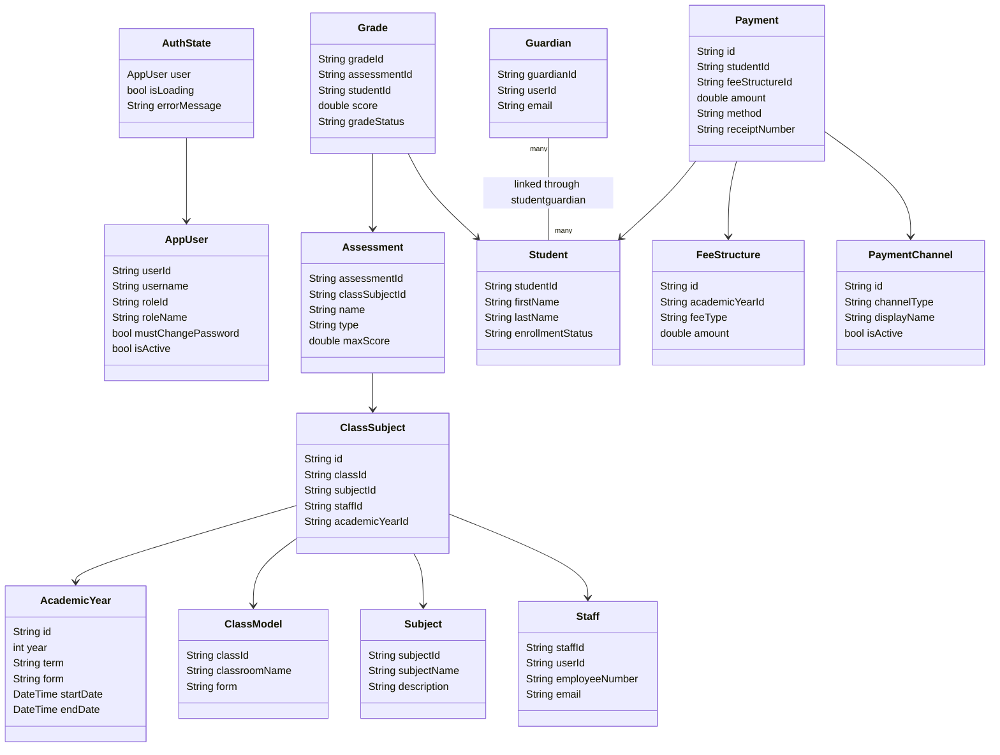

# Domain and application models

This focused class diagram includes persisted-facing DTOs and the main auth state. It deliberately omits widgets. Sources: model files under [`lib/features`](../../lib/features/) and assessment repositories.

Progression, weeding, audit, and several report payloads are currently `Map<String,dynamic>` rather than named Dart models; their class relationships are therefore not invented here.
