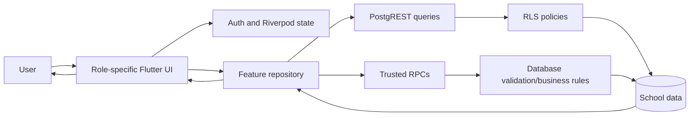
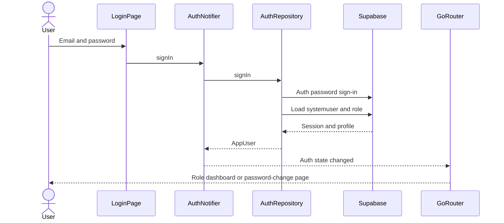
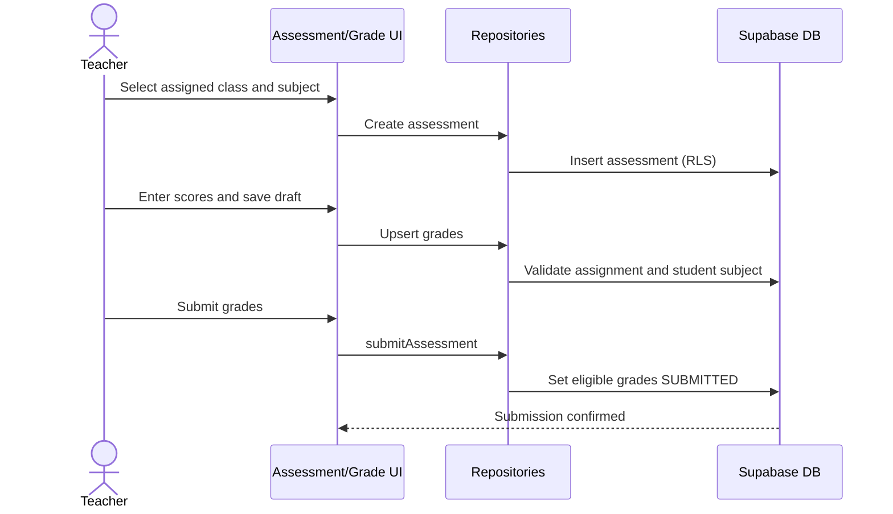
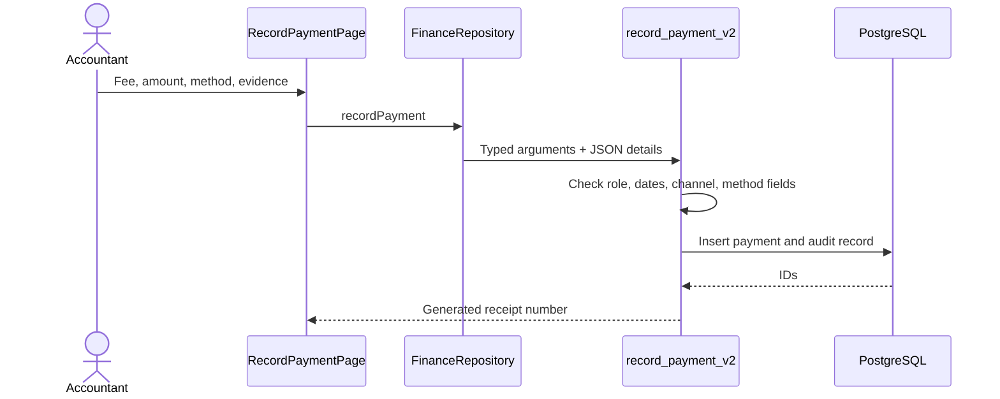
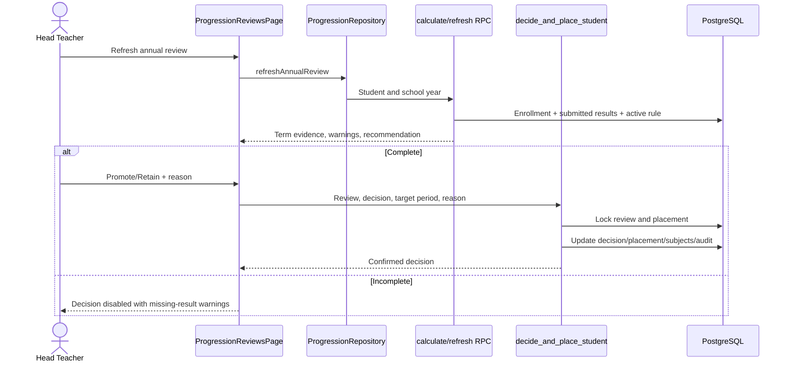

# Data flows and key sequences

The data-flow diagram covers authentication, academic operations, assessment, finance, and progression. Sources: feature repositories under [`lib/features`](../../lib/features/) and migrations [`0036`](../../supabase/migrations/0036_three_term_progression.sql), [`0040`](../../supabase/migrations/0040_progression_and_grade_security.sql), and [`0042`](../../supabase/migrations/0042_configurable_payment_channels.sql).

## Authentication

## Assessment submission

## Payment recording

## Progression decision

