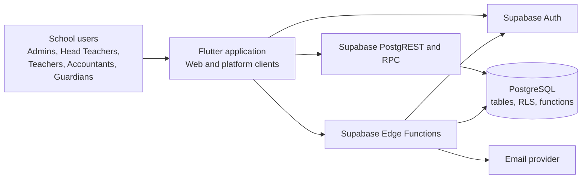
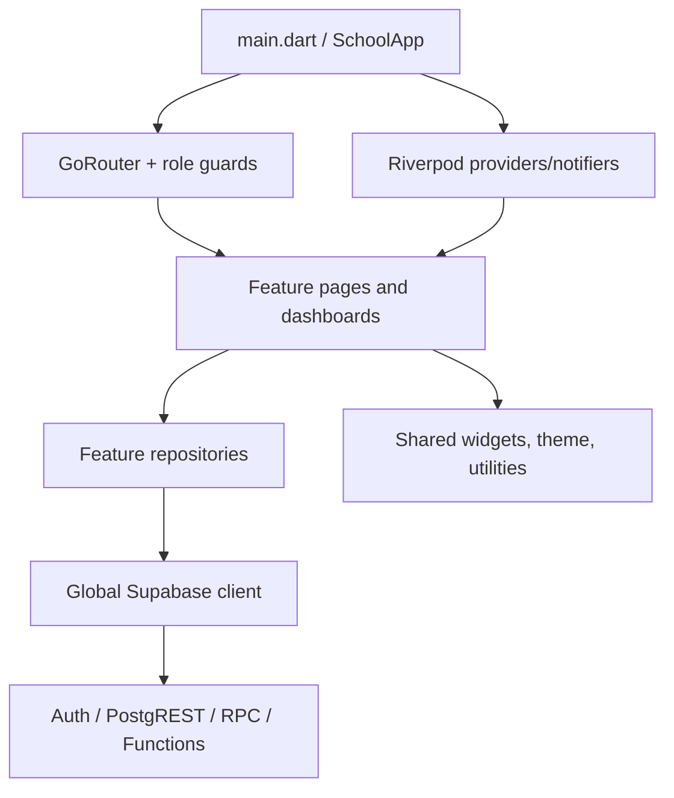

# System context and components

This diagram includes user roles, the Flutter client, Supabase boundaries, and external email delivery. Implementations: [`lib/main.dart`](../../lib/main.dart), [`lib/core/router.dart`](../../lib/core/router.dart), [`supabase/functions`](../../supabase/functions/).

The component diagram shows the principal in-process responsibilities. Feature repositories and some page-local providers share the same Supabase boundary.

