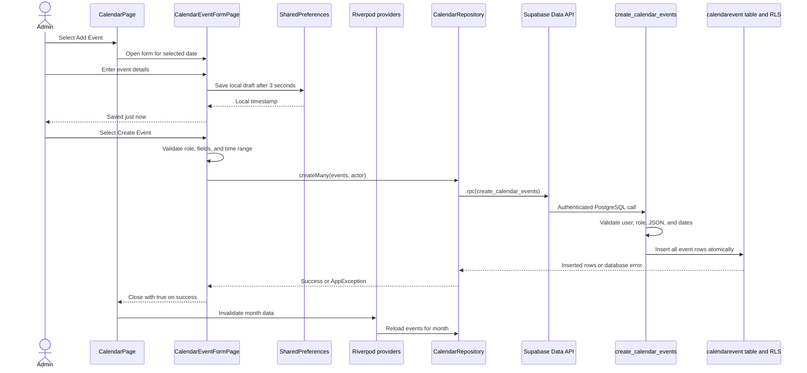

# How the calendar event code works

This document explains the calendar feature from the button in the browser to the row stored in Supabase. It also explains why the form can say `Saved 1m ago` while the real `Create Event` operation fails.

The walkthrough is based on the code as it exists on 2026-10-13. File names and function names are the stable references; line numbers may move as the code changes. Serena is not installed in the current development session, so the code was traced with symbol-aware repository search and direct source inspection.

## The short version

There are two independent save systems in the event form:

1. **Draft autosave** stores the unfinished form in the browser's local SharedPreferences storage. It never creates a calendar event in Supabase.
2. **Create Event** validates the form, builds one or more `CalendarEvent` objects, calls `CalendarRepository.createMany`, and asks the Supabase database function `create_calendar_events` to insert the rows.

That separation is why both messages can appear at once:

- `Saved 1m ago` means the local draft was saved successfully.
- `Error saving event: Something went wrong...` means the separate Supabase request failed.

## End-to-end architecture



## File map

| Layer | File and important code | Responsibility |
| --- | --- | --- |
| Routes | [`lib/core/router.dart`](../lib/core/router.dart), `_isRouteAllowedForRole`, routes near lines 505-515 | Decides who may open calendar routes and builds the list, create, and edit pages. |
| Role policy | [`lib/core/auth/school_role_access.dart`](../lib/core/auth/school_role_access.dart), `canManageSchoolCalendar` | Normalizes `SYSTEM_ADMIN` to `SUPER_USER` and allows `SUPER_USER`, `ADMINISTRATOR`, and `ADMIN` to manage events. |
| Calendar screen | [`lib/features/calendar/presentation/pages/calendar_page.dart`](../lib/features/calendar/presentation/pages/calendar_page.dart), `_openEditor` and `build` | Displays the month, opens the form, and refreshes the month after a successful create, edit, or delete. |
| Event form | [`lib/features/calendar/presentation/pages/calendar_event_form_page.dart`](../lib/features/calendar/presentation/pages/calendar_event_form_page.dart), `_loadFormState`, `_autoSaveFormState`, and `_save` | Owns the inputs, draft autosave, validation, event expansion, and submit feedback. |
| Riverpod state | [`lib/features/calendar/presentation/calendar_providers.dart`](../lib/features/calendar/presentation/calendar_providers.dart) | Provides the repository and asynchronously loads events, classes, and academic years. |
| Domain model | [`lib/features/calendar/domain/models/calendar_event.dart`](../lib/features/calendar/domain/models/calendar_event.dart), `CalendarEvent` | Converts database maps into Dart objects and Dart objects into insert maps. |
| Data access | [`lib/features/calendar/data/calendar_repository.dart`](../lib/features/calendar/data/calendar_repository.dart), `createMany` | Reads and writes calendar data through the global Supabase client and maps database errors into application exceptions. |
| Supabase startup | [`lib/core/database/supabase_client.dart`](../lib/core/database/supabase_client.dart), `initSupabase` | Reads `SUPABASE_URL` and `SUPABASE_PUBLISHABLE_KEY`, initializes the client, and exposes it as `supabase`. |
| Local draft storage | [`lib/core/utils/form_state_persistence.dart`](../lib/core/utils/form_state_persistence.dart), `FormStatePersistence` and `AutoSaveIndicator` | Stores draft JSON and a timestamp in SharedPreferences, then renders `Saving...` or `Saved ... ago`. |
| Database repair | [`supabase/migrations/20261012142221_repair_calendar_admin_authors.sql`](../supabase/migrations/20261012142221_repair_calendar_admin_authors.sql) | Repairs author columns, RLS policies, grants, and the atomic batch-create function. |
| Error tests | [`test/calendar/calendar_repository_error_test.dart`](../test/calendar/calendar_repository_error_test.dart) | Checks the messages produced for missing schema, missing RPC, and permission failures. |

## 1. Opening the calendar

The router registers three routes in `lib/core/router.dart`:

- `/calendar` creates `CalendarPage`.
- `/calendar/new` creates a blank `CalendarEventFormPage`.
- `/calendar/:eventId/edit` loads an event through `_CalendarEditLoader` before opening the same form in edit mode.

All authenticated roles can view `/calendar`. The router blocks child paths such as `/calendar/new` unless `canManageSchoolCalendar` returns true. The calendar page repeats this check before displaying the `Add Event` floating button. The repeated check improves the interface, while the router prevents direct navigation.

`CalendarPage.build` watches `calendarMonthProvider` for the focused month. That provider calls `CalendarRepository.listForMonth`, which calculates the month's date range and queries events that overlap it.

When an administrator selects `Add Event`, `_openEditor` opens the form in a dialog. If the form closes with `true`, the page invalidates `calendarMonthProvider`, which causes Riverpod to fetch the updated month.

## 2. Loading the form

`CalendarEventFormPage.initState` creates the name and description controllers and a three-second `AutoSaveDebouncer`.

The form has three startup paths:

1. **Edit mode:** copy the existing event into the form fields.
2. **New event with a selected date:** initialize the form with that calendar date.
3. **Other new event:** call `_loadFormState` to restore an unfinished local draft.

The form also watches:

- `calendarClassesProvider`, which loads `classid` and `classroomname` from `class`.
- `calendarYearsProvider`, which loads IDs, labels, and terms from `academicyear`.

These lists populate the class and academic-year selectors. Leaving the class empty creates a school-wide event.

## 3. What the autosave message really means

Each relevant field change calls `_onFieldChanged`. The debouncer waits three seconds and then calls `_autoSaveFormState`.

`_autoSaveFormState` calls `FormStatePersistence.saveFormStateWithTimestamp`. That method:

1. Serializes the form values as JSON.
2. Stores the JSON under a `form_state_...` key in SharedPreferences.
3. Stores the current local timestamp under a second key.

The form then updates `_lastSavedTime`. `AutoSaveIndicator` converts the timestamp to `Just now`, `1m ago`, and similar text.

This path does not call `CalendarRepository`, Supabase, `create_calendar_events`, or the `calendarevent` table. The message is therefore a **draft recovery indicator**, not confirmation that an event was created.

The approved UI follow-up is to remove this visible indicator while retaining silent draft recovery. The local draft should still be cleared only after a successful server submission.

## 4. What happens when Create Event is selected

The submit path is `_save` in `calendar_event_form_page.dart`, currently near lines 266-402.

### Client-side validation

The method first:

1. Runs the Flutter form validators.
2. Combines the selected dates and times.
3. Rejects an end time that is not after the start time.
4. Cancels a pending draft autosave.
5. Reads the authenticated user and repository from Riverpod.
6. Checks `canManageSchoolCalendar` again.

### Building the event objects

The form creates a draft `CalendarEvent` containing the selected class, academic year, event type, description, dates, and authenticated user ID.

For a new event, it then expands that draft:

- The primary date and every additional date each become an event.
- A timetable event with `Apply to all classes` becomes one event per date per class.
- Multi-day duration is preserved by calculating the day offset between the original start and end.

The completed list is passed to:

```dart
await repo.createMany(
  events: events,
  actorUserId: actor.userId,
  actorRole: actor.roleName,
);
```

For an existing event, the form calls `CalendarRepository.update` instead.

### Success behavior

After a successful create or update, the form:

1. Shows a green success snackbar.
2. Clears the local draft for a newly created event.
3. Closes with result `true`.
4. Lets `CalendarPage` invalidate and reload the month provider.

### Failure behavior

On failure, `_save` catches the exception and displays:

```dart
Text('Error saving event: $e')
```

The form stays open and the local draft remains available.

## 5. Model serialization

`CalendarEvent.toInsertMap` converts the Dart object to the database field names expected by PostgREST and PostgreSQL:

| Dart property | Database key |
| --- | --- |
| `classId` | `classid` |
| `createdBy` | `createdby` for a legacy staff author, only when non-empty |
| `createdByUser` | `createdbyuser` |
| `eventName` | `eventname` |
| `eventType.value` | `eventtype` |
| `description` | `description` |
| `startTime` | `starttime`, converted to UTC ISO-8601 |
| `endTime` | `endtime`, converted to UTC ISO-8601 |
| `allDay` | `allday` |
| `academicYearId` | `academicyearid` |

`CalendarEvent.fromMap` performs the reverse conversion for rows returned by Supabase. Timestamps are converted back to local time. Joined class, staff, and academic-year values become display labels.

## 6. Repository and Supabase request

`CalendarRepository.createMany` does three things:

1. Calls `_requireAdmin` to enforce the role in Dart.
2. Rejects an empty event list.
3. Calls the Supabase RPC:

```dart
await supabase.rpc(
  'create_calendar_events',
  params: {'events': events.map((e) => e.toInsertMap()).toList()},
);
```

The global `supabase` client comes from `lib/core/database/supabase_client.dart`. Its URL and publishable key must be supplied at Flutter build/run time. Missing values stop application startup rather than silently using an unauthenticated database client.

## 7. Database validation and insertion

The repair migration defines `public.create_calendar_events(events jsonb)` as `SECURITY INVOKER`. It therefore runs with the authenticated caller's database privileges and remains subject to row-level security.

The function:

1. Reads the caller from `auth.uid()`.
2. Reads the active application role through `public.current_app_role()`.
3. Allows the administrative calendar roles.
4. Requires between 1 and 366 event objects.
5. Validates every event name, event type, and time range.
6. Ignores any client-supplied author and writes `createdbyuser = auth.uid()`.
7. Inserts all rows in one SQL statement.
8. Returns all inserted rows.

Because the events are inserted in one database statement, the batch is atomic. If one row fails, none of the selected dates is committed.

The same migration gives authenticated users read access to events, limits create/update/delete policies to calendar administrators, revokes function execution from `PUBLIC` and `anon`, grants it to `authenticated`, and asks PostgREST to reload its schema cache.

## 8. Why the generic error hides the cause

`CalendarRepository.createMany` catches the original Supabase exception and passes it to `mapCalendarException`.

The mapper recognizes:

- Missing RPC or stale schema-cache errors.
- Missing `createdbyuser` schema errors.
- Permission errors.
- Not-found errors.
- Common network errors.

Every other exception becomes:

```dart
ServerException('Something went wrong. Please try again.')
```

`AppException.toString` returns only its safe message. By the time the form displays `$e`, the original PostgREST code and details have been discarded. This protects users from raw database output, but it also prevents the current browser screenshot from revealing the real remaining failure.

The next repair should log the original exception for developers before showing the safe user message. Sensitive tokens and credentials must never be logged.

## 9. What has already been proved

The following checks were completed against the linked database while diagnosing the screenshot:

- The active administrator account used for the test has the `SUPER_USER` role.
- The selected class `Form 1 B` exists.
- The selected `2025/2026` academic-year/term record exists.
- The repaired `create_calendar_events(jsonb)` function exists and is exposed to authenticated users.
- An exact equivalent of the screenshot payload succeeded inside a live transaction and was rolled back after verification.
- An anonymous REST request reached the RPC endpoint and was rejected for authentication, rather than reporting that the function did not exist.

These checks prove that the tested data, SQL function, and core insert path are valid. They do **not** prove what happened inside the failing browser request. The unresolved boundary is between the Flutter web client and the Supabase RPC response. Capturing the original client exception or browser network response is required to name that final cause with certainty.

## 10. Recommended next calendar change

The approved repair direction is:

1. Keep local draft recovery but remove `AutoSaveIndicator` from the app bar.
2. Preserve role and time validation in the form.
3. Improve developer-only error logging so the original Supabase/PostgREST code is retained.
4. Show specific safe messages for schema, permission, network, and validation failures.
5. Add regression coverage for the create path and error mapping.
6. Re-run Flutter analysis, calendar tests, and a real authenticated browser save.

The exact persistence choice, keeping the RPC or using one direct multi-row insert, should be decided from the captured browser error. The database RPC already succeeds in an isolated authenticated SQL test, so replacing it before seeing the actual browser error could hide rather than explain the remaining problem.

## Glossary

- **Riverpod provider:** an object that supplies state or services to Flutter widgets and can trigger refreshes.
- **Repository:** the Dart layer that owns database calls so widgets do not contain Supabase queries.
- **RPC:** a PostgreSQL function exposed through the Supabase Data API.
- **RLS:** PostgreSQL row-level security, which decides which rows an authenticated role may read or change.
- **SharedPreferences:** local key/value storage in the browser or device. It is not the school database.
- **Schema cache:** PostgREST's cached description of database tables and functions.
- **Atomic:** all operations succeed together or all are rolled back together.
