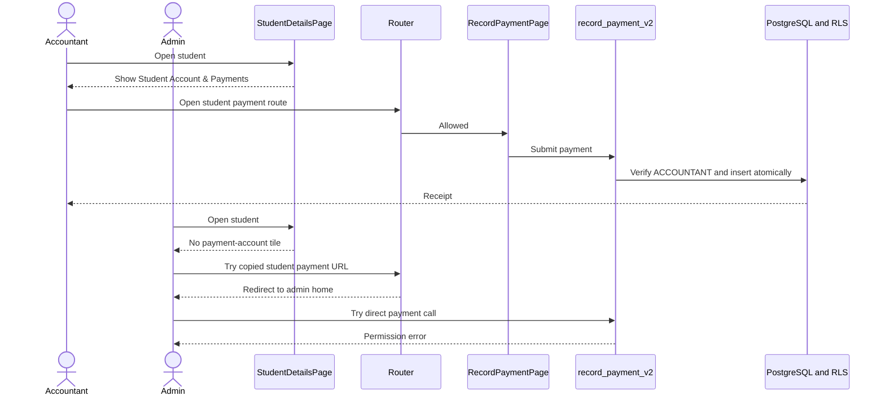

# Accountant-only student payment recording

## Problem

The student details page currently displays `Student Account & Payments` to both `ACCOUNTANT` and `SUPER_USER`. The linked account page exposes `Record Payment`, and the route configuration broadly allows administrators and super users to open `/finance/` URLs.

The database has the same mismatch. `record_payment_v2` currently accepts `ACCOUNTANT`, `SUPER_USER`, and `SYSTEM_ADMIN`, while the existing payment RLS management policy also permits `SYSTEM_ADMIN` to modify payment rows directly.

The required business rule is that accountants record student payments. Administrators and super users may retain financial oversight and configuration access, but they must not enter or modify student payments.

## Considered approaches

### 1. Accountant-only workflow with defense in depth, approved

Hide the student payment entry point from administrators, block direct student-payment routes, and enforce the same rule in PostgreSQL. Keep the existing pages for accountants and keep administrative read-only reports and payment configuration.

This approach matches the business responsibility and prevents bypass through a copied URL or a direct API call.

### 2. Hide the button only

This is the smallest UI change, but administrators could still open the known URL and the database would still accept some administrative payment writes. This approach is rejected because hidden navigation is not access control.

### 3. Delete the account and payment pages

This would also remove the workflow from accountants. This approach is rejected because the school still needs an authorized role to record payments.

## Role behavior

| Capability | Accountant | Super user/system admin | Administrator | Other roles |
| --- | --- | --- | --- | --- |
| See `Student Account & Payments` on student details | Yes | No | No | No |
| Open `/finance/students/:id/account` | Yes | No | No | No |
| Open `/finance/students/:id/pay` | Yes | No | No | No |
| Call `record_payment_v2` successfully | Yes, when active and linked to staff | No | No | No |
| Insert/update/delete `payment` directly | Yes, subject to RLS | No | No | No |
| View administrative payment reports | Yes | Yes | Yes | Existing role rules remain |
| Manage payment-channel configuration | No | Yes | Yes | No |

`SYSTEM_ADMIN` remains normalized to `SUPER_USER` in Flutter. Neither spelling receives student-payment recording access.

## Flutter design

### Shared role rule

Add `canRecordStudentPayments(String role)` to [`lib/core/auth/school_role_access.dart`](../../../lib/core/auth/school_role_access.dart). It returns true only when the normalized role is `ACCOUNTANT`.

This gives the UI and router one source of truth instead of repeating string comparisons.

### Student details

Update [`lib/features/students/presentation/student_details_page.dart`](../../../lib/features/students/presentation/student_details_page.dart) to use `canRecordStudentPayments` for the `Student Account & Payments` tile.

No student data, guardian, subject, class-history, or edit behavior changes.

### Route enforcement

Update `_isRouteAllowedForRole` in [`lib/core/router.dart`](../../../lib/core/router.dart) with a specific check before the broad role-prefix check:

- Any path starting with `/finance/students/` requires `canRecordStudentPayments`.
- A disallowed user is redirected to that role's normal home page by the existing router redirect.

The route definitions and pages stay in the application because accountants still use them.

### Administrative dashboards

Do not remove the administrator's `Payments` overview, fee structures, reports, or payment configuration. Those are oversight and setup capabilities, not the student-specific recording workflow shown in the screenshots.

There is no separate administrator `Record Payment` dashboard action to remove. The exposed recording path begins at the student details tile, then continues through `StudentAccountPage` to `RecordPaymentPage`.

## Database design

Create a new forward migration using the installed Supabase CLI rather than editing migration `0042` in place.

The migration will:

1. Replace the `record_payment_v2` role condition so only an active `ACCOUNTANT` with the required staff link may continue.
2. Keep the function's existing input validation, atomic payment/audit behavior, duplicate protection, and generated receipt behavior.
3. Preserve the existing function signature so Flutter requires no repository change.
4. Keep execution revoked from `PUBLIC` and granted only to `authenticated`.
5. Replace the broad payment management policy with an accountant-only management policy containing both `USING` and `WITH CHECK`.
6. Add or preserve a separate select-only policy for `SUPER_USER`, `SYSTEM_ADMIN`, and `ADMINISTRATOR` so administrative reports remain readable.
7. Leave guardian-linked and other existing read-only payment policies intact.
8. Notify PostgREST to reload its schema cache.

`record_payment_v2` is currently a `SECURITY DEFINER` function. This migration will not widen its privileges. Its explicit authenticated-user, active-account, staff-link, and accountant-role checks are therefore mandatory, and `PUBLIC` execution must remain revoked.

## Data flow after the change

## Error handling

- Route denial uses the existing role-home redirect, so no broken or blank page appears.
- A stale page or direct API call receives the database's safe `Only an active accountant may record payments` permission error.
- Existing form validation and finance repository exception mapping remain responsible for normal amount, date, channel, and transaction errors.

## Testing and verification

### Flutter tests

- `ACCOUNTANT` passes `canRecordStudentPayments`.
- `SUPER_USER`, `SYSTEM_ADMIN`, `ADMINISTRATOR`, and all other roles fail it.
- Existing calendar and review role tests continue to pass.
- If practical with the existing provider setup, add a widget assertion that the student payment tile is visible only to an accountant.

### Route checks

- Accountant can open both student account and payment routes.
- Super user and administrator direct URLs redirect to their home routes.
- Administrator can still open the read-only payment overview and payment configuration.

### Database checks

- Run the migration against the linked project only after reviewing the generated SQL.
- An authenticated accountant can call `record_payment_v2` in a transaction and the test row can be rolled back or removed safely.
- Super user, system admin, and administrator calls fail with SQLSTATE `42501`.
- Accountant direct insert/update/delete follows the management policy.
- Administrative `SELECT` continues to work, while direct insert/update/delete fails.
- Run Supabase database advisors and inspect migration status.

### Project verification

- Run the focused role, router, student, and finance tests.
- Run `flutter analyze`.
- Run the full Flutter test suite.
- Verify the behavior in a release-mode web session as both accountant and super user.

## Out of scope

- Deleting historical payment records.
- Removing guardian payment history.
- Removing administrative payment reports, fee structures, or payment-channel configuration.
- Changing payment amounts, methods, receipts, or audit content.
- Changing which roles manage calendar events.
